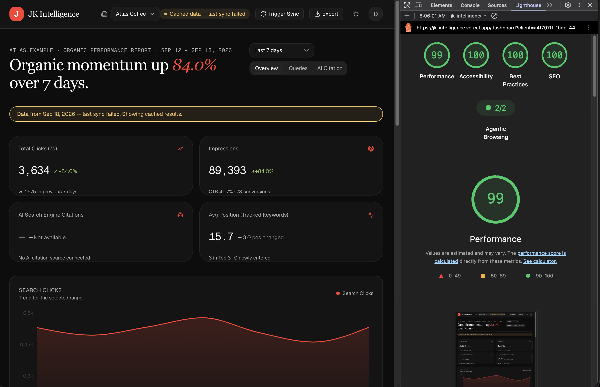

# JK Intelligence

Multi-client SEO reporting platform. A signed-in user views one client's search performance at a time; admins provision clients, members and credentials. Next.js 16 (App Router), React 19, TypeScript, Supabase Postgres with RLS and auth, shadcn/ui on Tailwind CSS 4, BullMQ on Upstash Redis, deployed to Vercel.

| Resource | Location |
| --- | --- |
| Live app | <https://jk-intelligence.vercel.app> |
| Source | <https://github.com/jkingz/jk-intelligence> |
| CI | [`.github/workflows/ci.yml`](.github/workflows/ci.yml) — unit, typecheck, lint, build, public e2e |
| Implemented surface | [`docs/architecture/README.md`](docs/architecture/README.md) |
| Contributing / agent rules | [`AGENTS.md`](AGENTS.md), then [`docs/conventions/project-rules.md`](docs/conventions/project-rules.md) |



*Seeded demo data, captured before the left rail was added — the account menu it shows in the header now sits in the rail footer.*

## Features and status

| Surface | Status | Detail |
| --- | --- | --- |
| Email/password auth, demo login | Live | `app/auth/*`, `lib/auth/`; the demo card is prop-fed from server-side env |
| Client switcher, dashboard reads | Live | Metric cards, click-trend chart and query table over seeded `current_metrics`, `7 \| 30 \| 90` ranges |
| CSV and PDF export | Live | `app/api/exports/*`, `lib/exports/`; fonts vendored so a sealed build runner needs no network |
| `/admin` | Live | Client and member provisioning through service-role RPCs |
| `/connections` | Read-only | Lists stored `api_credentials` rows; the Connect button is inert and no OAuth flow exists |
| Data sync | Mock | Vercel cron enqueues one `seo-sync` job per active client; no production consumer drains the queue. `pnpm worker` runs [`lib/queue/worker.ts`](lib/queue/worker.ts), which returns `mock_completed`. Trigger Sync animates its own state only |
| Stale banner, sync pill | Read-only | Renders the stored `is_stale` column; its only writer, `markMetricsStale` in [`lib/db/repository.ts`](lib/db/repository.ts), has no caller |
| AI citations, autonomous brief | Not built | `lib/dashboard/overview.ts` hardcodes `aiCitations: []`; no LLM dependency in the repo. The brief phrases the numbers it is handed |

Unbuilt design intent lives in [`docs/target-state/README.md`](docs/target-state/README.md) and is never a description of current behaviour. Current scope and open product questions: [`docs/context/project-overview.md` § Project Overview → Status](docs/context/project-overview.md#status).

## Architecture



*The diagram draws the whole planned pipeline, including the AI nodes that are not built. Which `lib/agents/` modules exist is [`docs/architecture/README.md` § Agents](docs/architecture/README.md#agents-libagents).*

Request path: browser → route handler in `app/api/` → session and tenant gates in [`lib/api/guard.ts`](lib/api/guard.ts) → repository read → Supabase Postgres. Tenant isolation is enforced by RLS policies, not by TypeScript — see [`docs/conventions/project-rules.md` § PROJECT RULES 15](docs/conventions/project-rules.md#15-tenant-isolation-is-rlss-job).

## Stack

| Layer | Choice | Note |
| --- | --- | --- |
| Framework | Next.js `16.3.5`, App Router | Its APIs differ from what most people remember: `proxy.ts` replaces `middleware.ts`. Read [`docs/conventions/project-rules.md` § PROJECT RULES 12](docs/conventions/project-rules.md#12-nextjs-16-is-a-fork-of-what-you-remember) before touching framework code |
| UI | React `19.3.0`, shadcn/ui, Tailwind CSS 4, lucide-react, Recharts, motion | Primitives in `components/ui/` and clients in `lib/supabase/` are protected — never edit them to make a feature pass |
| Data | Supabase Postgres + RLS, `@supabase/ssr` | SQL lives in `supabase/migrations/`, applied by `pnpm db:migrate` |
| Queue | BullMQ on Upstash Redis | `lib/queue/`, plus the Vercel cron in [`vercel.json`](vercel.json) |
| Language | TypeScript 5.9 (`@/` alias), Zod 4 | Shared shapes in `types/` |
| Tests | Vitest 5 (one project per tier), Playwright | [Testing and CI](#testing-and-ci) |
| Toolchain | pnpm 10, Node 24 | `package-lock.json` was deleted on purpose — do not regenerate it with npm. `next-themes` is patched from `patches/` |

## Getting started

| Requirement | Value |
| --- | --- |
| Node | `>=24.0.0` |
| pnpm | `>=10` (`packageManager: pnpm@10.18.3`) |
| Database | A Supabase project, or the local stack: `pnpm exec supabase start` (`supabase/config.toml` is committed) |

```bash
pnpm install
cp .env.example .env    # fill in values; copy names, never values
pnpm dev                # http://localhost:3000
```

Then provision the database and the accounts:

| Step | Command or action |
| --- | --- |
| 1 | In Supabase: enable the email/password provider and add `/auth/callback` to the redirect allowlist |
| 2 | `pnpm db:migrate` — apply `supabase/migrations/` |
| 3 | `pnpm db:seed` — demo metric rows; `pnpm db:seed-connections` — demo credential rows |
| 4 | `pnpm db:demo-user` — demo account; add `-- --admin` for the control-plane admin |

> Every `db:*` script reads `.env` (then `.env.local`) first, so confirm it points at your local stack before running one — `db:seed-connections --reset` deletes rows. Rules: [`docs/conventions/project-rules.md` § PROJECT RULES 16](docs/conventions/project-rules.md#16-supabase).

## Environment

[`.env.example`](.env.example) is the authority: every name, its placeholder, and which layer reads it. The groups below are what each one unlocks.

| Group | Names | Unlocks |
| --- | --- | --- |
| Supabase, public | `NEXT_PUBLIC_SUPABASE_URL`, `NEXT_PUBLIC_SUPABASE_PUBLISHABLE_KEY` (legacy `NEXT_PUBLIC_SUPABASE_ANON_KEY` also works) | Browser and server clients. These two, as placeholders, are all CI needs |
| Supabase, server-only | `SUPABASE_SERVICE_ROLE_KEY`, `SUPABASE_DB_URL` | The `getAdminDb` read path and the `db:*` scripts, which accept `DATABASE_URL` as a fallback |
| Queue and quota | `UPSTASH_REDIS_REST_URL`, `UPSTASH_REDIS_REST_TOKEN`, `REDIS_URL` | BullMQ and the export quota; `REDIS_URL` wins over the Upstash pair when set |
| Routing | `NEXT_PUBLIC_APP_URL`, `CRON_SECRET` | The revalidate loop (`VERCEL_URL` is the fallback) and the bearer check on `/api/cron/sync` plus `/api/revalidate/dashboard` |
| Demo and admin accounts | `DEMO_EMAIL`, `DEMO_PASSWORD`, `DEMO_CLIENT_ID`, `ADMIN_EMAIL`, `ADMIN_PASSWORD` | Server-side only, prop-fed to the login card. Never `NEXT_PUBLIC_*` — those ship in the client bundle |
| Tests (`.env.test`) | `TEST_SUPABASE_URL`, `TEST_SUPABASE_PUBLISHABLE_KEY`, `TEST_SUPABASE_SERVICE_ROLE_KEY`, `TEST_DEMO_PASSWORD` | Integration and authed e2e tiers. The `TEST_` prefix is deliberate: a leaked live name must not point tests at production |

## Scripts

| Command | Does |
| --- | --- |
| `pnpm dev` / `pnpm build` / `pnpm start` | Next.js server |
| `pnpm lint` / `pnpm typecheck` | ESLint / `next typegen && tsc --noEmit` |
| `pnpm test` | Vitest **unit project only** — not the whole suite |
| `pnpm test:all` | Every Vitest tier |
| `pnpm test:integration` | Integration tier against live Postgres (`--passWithNoTests`) |
| `pnpm test:e2e` / `pnpm test:e2e:auth` | Playwright public tier / authed tier |
| `pnpm db:migrate` | Apply `supabase/migrations/`, record them in `public.schema_migrations` |
| `pnpm db:seed` / `pnpm db:seed-connections` | Demo `current_metrics` / `api_credentials` rows |
| `pnpm db:demo-user` | Provision the demo user (`-- --admin` for the admin) |
| `pnpm worker` | Run the queue consumer locally (the mock) |

## Testing and CI

| Tier | Command | Requires | In CI |
| --- | --- | --- | --- |
| unit | `pnpm test` | nothing | yes |
| integration | `pnpm test:integration` | local stack running + filled `.env.test` | no |
| e2e, public | `pnpm test:e2e` | build only, no database | yes |
| e2e, authed | `pnpm test:e2e:auth` | real credentials | no, local-only by design |

Gate before reporting work complete:

```bash
pnpm test && pnpm typecheck && pnpm lint && pnpm build
```

[`docs/conventions/project-rules.md` § PROJECT RULES 13](docs/conventions/project-rules.md#13-verification-gates) owns the push gate, which adds `pnpm test:all` and `pnpm test:e2e` and defines green / waived / red. Two things that bite:

- A green integration run can mean nothing ran — files skip on `TEST_SUPABASE_URL` being *set* rather than reachable, so read the passed/skipped counts, not the exit code.
- Narrow with `pnpm test dashboard`; `pnpm test -- dashboard` silently runs everything.

Which test folder covers which feature: [`docs/architecture/README.md` § Verification](docs/architecture/README.md#verification).

## Deployment

| Item | Value |
| --- | --- |
| Target | Vercel, production at `jk-intelligence.vercel.app` |
| Scheduled job | `vercel.json` → `GET /api/cron/sync` at `0 2 * * *`, authenticated by `CRON_SECRET` |
| Secrets | Set in the Vercel project, mirroring the names in `.env.example`; a missing `DEMO_EMAIL`/`DEMO_PASSWORD` silently hides the demo login card |
| Offline build probe | `NODE_USE_ENV_PROXY=1 HTTPS_PROXY=http://127.0.0.1:9 pnpm build` |
| Queue consumer | None hosted. `pnpm worker` is local only, which is why sync stays a mock |

## Repository layout

| Path | Contents |
| --- | --- |
| `app/` | Routes: public pages (`/`, `/auth/*`, `/privacy`, `/terms`), the `app/(app)/` shell (`/dashboard`, `/connections`, `/admin`, `/profile`), `app/api/` handlers |
| `components/` | `ui/` primitives and `features/<slug>/` feature folders |
| `lib/` | Server logic: `db/`, `auth/`, `api/`, `dashboard/`, `connections/`, `admin/`, `exports/`, `queue/`, `cache/`, `agents/`, `navigation/`, `supabase/` |
| `hooks/`, `types/` | Client hooks; shared type modules |
| `tests/` | `tests/<feature>/<tier>/` — `unit`, `integration`, `e2e` |
| `specs/` | One file per deliverable unit; start from [`specs/00-template.md`](specs/00-template.md) |
| `supabase/` | `config.toml` and timestamped `migrations/` |
| `scripts/` | The `db:*` helpers |
| `docs/` | Context, architecture, conventions, maintenance rules, dated plans |
| `patches/` | The pnpm patch for `next-themes@0.4.6` |
| `.claude/skills/`, `.agents/skills/` | Repo skills, mirrored per entry — inventory in [`docs/architecture/README.md` § Repo skills](docs/architecture/README.md#repo-skills) |

## Documentation

| Question | File |
| --- | --- |
| What is the product, its scope, its open questions | [`docs/context/project-overview.md`](docs/context/project-overview.md) |
| Stack, boundaries, storage model, tenancy, invariants | [`docs/context/architecture-context.md`](docs/context/architecture-context.md) |
| Theme, tokens, typography, dashboard patterns | [`docs/context/ui-context.md`](docs/context/ui-context.md) |
| Language, Next.js, React, styling, API, data and testing conventions | [`docs/context/code-standards.md`](docs/context/code-standards.md) |
| The per-unit loop, scoping, verification order, commands | [`docs/context/development-workflow.md`](docs/context/development-workflow.md) |
| Commit and PR conventions | [`docs/context/pm-conventions.md`](docs/context/pm-conventions.md) |
| What exists today: request path, HTTP surface, queue and cron, pages, verification | [`docs/architecture/README.md`](docs/architecture/README.md) |
| What is planned but not built | [`docs/target-state/README.md`](docs/target-state/README.md) |
| Project rules 11–17, feature folder layout, wiring | [`docs/conventions/project-rules.md`](docs/conventions/project-rules.md), [`docs/conventions/feature-components.md`](docs/conventions/feature-components.md) |
| Dated log of shipped work | [`docs/progress-tracker.md`](docs/progress-tracker.md) — history, not the live record |
| How to edit these docs, and the checks that keep them honest | [`docs/maintenance/README.md`](docs/maintenance/README.md) |

Cross-file citations in these docs use the repo's `§` section marker, defined in [`docs/maintenance/README.md` § Notation](docs/maintenance/README.md#notation).

## Contributing

| Step | Rule |
| --- | --- |
| Spec | `specs/<nn>-<slug>.md`, from [`specs/00-template.md`](specs/00-template.md) — numbers belong only to spec filenames |
| Components | `components/features/<slug>/`, exported through `index.ts` — [`docs/conventions/feature-components.md`](docs/conventions/feature-components.md) |
| Tests | `tests/<feature>/<tier>/`, named `<sut>.test.ts` (unit, integration) or `<flow>.spec.ts` (e2e); import the subject through `@/`, never relatively |
| Branch and title | `feat/<slug>` / `feat(<slug>): <summary>` |
| Record | Append the unit to [`docs/progress-tracker.md`](docs/progress-tracker.md) § Completed **after** verification |
| Ship | Commit, push and open PRs only when asked — [`docs/context/pm-conventions.md`](docs/context/pm-conventions.md) |

`AGENTS.md` § STANDING RULES and [`docs/conventions/project-rules.md`](docs/conventions/project-rules.md) § PROJECT RULES bind every change.
